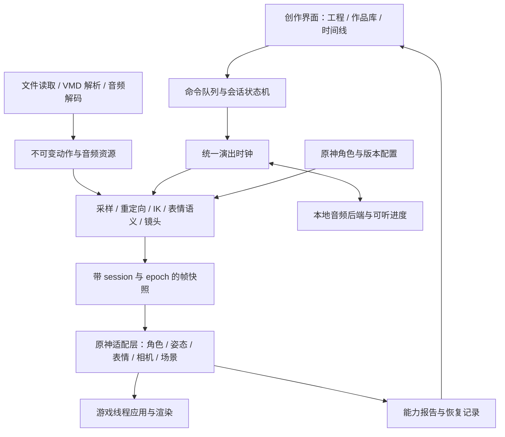

# 原神客户端内 MMD 创作工具实施计划

编制日期：2026-10-12。目标环境：原神正式客户端内创作；首发平台暂定 Windows x64。

本文是源码调研后的设计方案。初次编制时工作区没有已有实现及原神实机资料。2026-10-12 已完成加载、465 节点角色层级读取、旋转验证、52 项绑定预览及单骨 1° 写入/即时恢复；最新进展见 [单骨恢复实验](SINGLE_BONE_ROUNDTRIP_RESULTS.md)，此前见 [骨架与旋转](HIERARCHY_OBSERVER_RESULTS.md)、[相机观察](CAMERA_OBSERVER_RESULTS.md) 和 [首轮记录](FIRST_PROTOTYPE_RESULTS.md)。下文尚未验收的设计仍属待验证项，尚未实现跨帧动作驱动或相机控制。

## 1. 目标与首要决策

目标工作流：导入 VMD 动作/表情/镜头及音乐 → 选择当前角色和舞台位置 → 调整动作比例、偏移与机位 → 同步预览、暂停、逐帧与跳转 → 隐藏创作面板并录制 → 保存工程并恢复游戏状态。

采用“独立 MMD 核心 + 原神适配层 + 创作界面”的结构。借鉴 EIEM 的动作采样与重定向算法，借鉴 Better-Endfield 的作品管理和统一调度；重新实现角色发现、骨架绑定、动画写入、表情、相机、布料和生命周期适配。

优先级：

1. **P0 可行性**：目标版本能否在允许的接入条件下稳定运行扩展、定位当前角色、控制少量骨骼与相机、停止后恢复。
2. **P1 单人 MVP**：VMD 全身与手指、基本足部 IK、镜头、音乐、作品工程、暂停/跳转/循环、基本表情。
3. **P2 创作增强**：表情覆盖扩展、关键帧运镜、服装物理控制、可验证的地形贴合、多人演员。
4. **P3 后续**：离线烘焙、Blender 联动、精确逐帧输出、其他平台。

客户端接入是独立前置条件。两个终末地项目的加载器不能证明原神可接入；本计划不预设原神暴露相同的 IL2CPP 导出，也不以修改反作弊、关闭完整性检查或隐蔽加载为实施路径。若正式客户端的接入条件无法满足，P0 应明确终止该路线，而不是将外部预览冒充客户端内完成。

## 2. 调研依据和源码级结论

Better-Endfield 调研基线：`44612aa5e4810536b91b3bf73bec7b236883deda`。EIEM 直接调研文件来自 2026-10-12 获取的 `main`；其文件摘要记录在 `references/SOURCE_MANIFEST.json`，应在实际代码移植前进一步锁定提交。Better-Endfield 内嵌的 EIEM 快照则标注为 `1bc9baa`，不能视为当前 EIEM main 的同一版本。

| 参考项目与源码 | 已确认的设计/实现 | 移植处理 |
|---|---|---|
| [EIEM README](https://github.com/Sasye/EIEM/blob/main/README.md) | 直接 VMD、FK/IK、表情、音频、相机、MUS4；多人列为计划 | 首选直接 VMD；MUS4 延后，不能假定目标角色支持 Humanoid muscle |
| [EIEM vmd_parser.h](https://github.com/Sasye/EIEM/blob/main/src/vmd_parser.h) | VMD 解析入口与轨道结构 | 提取格式/采样部分，去掉运行时全局依赖 |
| [EIEM bone_map.h](https://github.com/Sasye/EIEM/blob/main/src/bone_map.h) | MMD 语义映射，同时包含 Bip001、眼睛等目标骨骼名称 | 保留 MMD 语义；所有终末地目标名称与绑定规则替换为原神 profile |
| [EIEM ghost_rig.h](https://github.com/Sasye/EIEM/blob/main/src/ghost_rig.h)、[leg_ik_player.h](https://github.com/Sasye/EIEM/blob/main/src/leg_ik_player.h) | GhostRig 与目标运行时的腿部解算结合 | 提取纯数学；首选自有双骨 IK，不要求原神存在 FinalIK |
| [EIEM smc_face.h](https://github.com/Sasye/EIEM/blob/main/src/smc_face.h) | 依赖 SkeletalMorphCore 的字段、缓存与更新顺序 | 重写 FaceAdapter；只复用 VMD 表情语义/别名思路 |
| [EIEM camera_player.h](https://github.com/Sasye/EIEM/blob/main/src/camera_player.h) | VMD 镜头求值和构图，包含目标相关比例常量 | 复用插值数学；单位、朝向、身高与 FOV 单独校准 |
| [BE shared/motion/vmd.h](https://github.com/Dr-hydra/Better-Endfield/blob/44612aa5e4810536b91b3bf73bec7b236883deda/native/shared/motion/vmd.h) | 共享 VMD 数据与采样实现 | 优先作为可移植解析层候选，先验证依赖与格式完整性 |
| [BE mmd_director_runtime.inc](https://github.com/Dr-hydra/Better-Endfield/blob/44612aa5e4810536b91b3bf73bec7b236883deda/native/modules/camera/mmd_director_runtime.inc) | 一条时间线调度动作、相机、音乐；有音频时以可听播放进度校正；异步加载有 generation | 保留调度规则，拆除 BE Music/Camera/Host 耦合 |
| [BE mmd_library.h](https://github.com/Dr-hydra/Better-Endfield/blob/44612aa5e4810536b91b3bf73bec7b236883deda/native/modules/camera/mmd_library.h) | set.ini 作品库、motion2..4、face2..4、audio_offset | 增加兼容导入器；原生工程格式支持角色、舞台和校准配置 |
| [BE EIEM/UPSTREAM.md](https://github.com/Dr-hydra/Better-Endfield/blob/44612aa5e4810536b91b3bf73bec7b236883deda/native/modules/camera/eiem/UPSTREAM.md) | 四份 slot 私有状态、共享舞台/时钟；多人依赖终末地 squad；Android 使用不同适配路径 | 参考状态隔离，改成显式 ActorSession 实例；不移植 squadManager 或四次编译头文件的方法 |
| [BE GAME_INTERFACES.md](https://github.com/Dr-hydra/Better-Endfield/blob/main/docs/host/GAME_INTERFACES.md) | Host 管理模块、契约解析与 Hook 所有权 | 参考能力探测、单一所有者、接口缺失时禁用对应功能 |

特别注意：BE 历史移植计划中的阶段勾选和源码存在，都不等于当前原神功能可用；其 UPSTREAM 文档也区分了离线验证与实机效果。两个参考项目有代码继承关系，复用时必须核对差异，不能将二者当成完全独立的功能模块拼接。

## 3. 功能范围与复用边界

| 功能 | 首版范围 | 主要难点 | 验证证据 |
|---|---|---|---|
| VMD 导入 | 骨骼、Morph、相机、IK 开关；30 fps 时间基准 | CP932 名称、异常文件、重复帧/边界帧 | 合成夹具与合法素材对照 |
| 全身动作 | 躯干、四肢、头颈、手指；Root/Center 分层 | 中性姿态、局部轴、比例、额外骨骼 | 校准动作和跨体型视频 |
| 足部 IK | 自有双骨求解、脚尖、逐腿 IK 开关 | 膝盖方向、接触、FK/IK 过渡 | 蹲起、旋转、跳跃、不对称 IK |
| 表情 | 眨眼、基础口型、眼睛；实际覆盖按 profile 展示 | 可能为骨骼/BlendShape/专用混合驱动 | 每个通道 0/0.5/1 和 Stop 恢复 |
| 相机 | VMD/自由/游戏机位切换、FOV、滚转 | 最终相机写入时序、坐标系、镜头抖动 | 标定图、横竖画幅、静止镜头 |
| 音频 | 本地 WAV/MP3、偏移、播放/暂停/跳转/循环 | 输出延迟、设备切换、跳转误差 | 打点片段与可听进度测量 |
| 工程与作品库 | set.ini 兼容导入、自有 JSON 工程、缺失文件报告 | 来源、相对路径、迁移 | 保存重开结果一致 |
| 拍摄辅助 | 面板显隐、可恢复的 HUD 控制（能力具备时） | UI 子树定位与场景恢复 | 不同场景 Stop/异常退出 |
| 服装/头发 | 首版保留原生行为；后续提供可恢复冻结/稳定模式 | 原神实际物理组件和 LOD 重建 | 长发、裙装、披风各自验证 |
| 多人同台 | 后续本地演出演员；数量由实测预算决定 | 原神队伍槽位是否有活跃可渲染实体、演员创建 | 双人先行，再测四人 |
| 地形贴合 | 后续可选；固定平面是首版基准 | 可靠地面查询、舞蹈接触语义 | 台阶/斜坡且跳跃不被吸地 |
| 录制/输出 | 首版预览配合外部录屏；记录时间线事件便于对齐 | 游戏渲染与音频均未提供逐帧输出保证 | 实录同步检查 |

模型替换、BEM 包、战斗统计、抽卡、配音切换和开屏不在此项目范围。舞蹈播放优先驱动渲染骨架，Root 位移不写入网络实体位置或战斗移动状态。需要扩大舞台移动时，应先验证视觉根节点、碰撞及镜头的关系。

## 4. 推荐架构



建议模块：

```text
src/core/          VMD、数学、采样、重定向、IK、时间线（不依赖游戏 SDK）
src/runtime/       ActorSession、Stage、Director、命令队列、资源任务
src/adapters/gi/   RuntimeBridge、Actor、Pose、Face、Camera、Physics、Scene
src/audio/         本地解码、输出、seek 与时钟测量
src/project/       工程读写、set.ini 导入、资源清单与迁移
src/ui/            控制面板与能力状态
profiles/          版本配置、骨骼映射、面部映射、标定参数
tests/             纯核心夹具、适配器模拟、实机验收清单
third_party/       经许可审核后移植的源码与出处（实现阶段建立）
```

技术栈暂定 C++20/CMake；UI 先采用独立控制窗口和命令桥接，接入机制经 P0 验证后决定是否引入游戏内面板。它仍控制客户端内的动作和画面。UI 框架和发布封装放在 P0 之后选择，不先复制整个 BE WinUI/Host 或 EIEM 代理加载器。

适配接口至少包括：

- RuntimeBridge：识别目标构建、报告可用接口、在正确游戏线程执行操作。
- ActorAdapter：取得当前可渲染角色、角色/模型代际、骨架、组件和有效性令牌。
- PoseAdapter：读取已验证的中性骨架、申请姿态控制、写入并释放。不得用进入播放时的随机动画帧冒充 bind pose。
- FaceAdapter：枚举可用表情通道，应用语义权重，保存/恢复原控制状态。
- CameraAdapter：取得最终可渲染相机及机位控制权，应用镜头，恢复游戏控制。
- SceneAdapter：场景切换通知、舞台参考、可用时的地面查询及拍摄 UI 控制。
- PhysicsAdapter：可选；查询组件、捕获状态、切换模式、验证恢复。

每项能力报告 `supported / unsupported / unverified / failed` 及具体原因。身体能力缺失拒绝演出；表情/地形/布料缺失允许明确降级。恢复失败时阻止再次申请同一对象的控制，先完成诊断。

## 5. 关键实现设计

### 5.1 原神接入与版本适配

P0 必须确定客户端版本/渠道、可用接入方式、渲染线程与游戏线程边界、运行时接口、对象失效信号。可以复用 BE 的“按契约验证能力”原则，但只有目标确实暴露相关接口时才选择相应解析实现；不假设类名或导出函数与终末地相同。

将版本相关信息隔离为 GameBuildProfile。入口未确认、类型或签名不匹配、骨骼层级不同，都返回可解释的能力失败，禁止猜偏移后继续写入。客户端更新后先探测，再开放创作；已验证旧版本结果不能替代新版本验收。

### 5.2 骨骼重定向与动画所有权

目标 profile 保存：骨骼语义到实际节点的映射、中性局部变换、局部轴基、骨长、手指/扭转骨、可选眼睛节点。骨骼名称只作为候选证据，还要校验父子关系、左右侧和长度。

源 VMD 缺少模型完整骨架信息，不能保证任意动作精确还原。首版内置明确标注的标准 MMD 源骨架；允许后续配置源骨架/合法 PMX 参考和按动作覆盖比例，缺少源信息时展示限制。

先在源骨架求值，合并 Center/Groove、上下半身和准标准辅助骨，再转到目标中性姿态。旋转转换使用已标定的局部基与四元数；位置仅映射明确的 Root/Center/IK 通道，不把所有 VMD 平移套到全部目标骨骼。

时序通过探针验证：原生动画求值 → 外部主体姿态 → 面部/眼睛 → 原生次级物理 → 最终渲染。实际实现必须根据目标顺序调整，不以一个未经验证的 LateUpdate 写入点作为最终方案。记录写入后与渲染前的差异，定位谁覆盖了姿态。

第一版先验证当前角色上的姿态控制；若游戏移动/状态机无法与视觉骨架隔离，评估独立本地演出模型。两种方案都需要通过 P0，不能把模型克隆当成已可用替代路线。

### 5.3 IK 与地形

腿部使用纯核心双骨 IK：可达范围约束、膝盖 pole、踝部旋转、脚尖修正；逐腿遵循 VMD IK 开关，并对切换做短过渡。腿长与舞台缩放分离，避免用身体缩放补偿脚部误差。

首版在固定舞台平面验证。地形阶段才接入经验证的地面查询，以原舞蹈的接触/抬脚意图决定吸附权重，加入步阶阈值、法线过滤、骨盆补偿和高度滤波。跳转/换场景清空接触缓存；跳跃、劈叉和有意悬空不能被强制贴地。

### 5.4 表情

先确认角色采用骨骼、BlendShape、专用组件或混合方案，再建立表情语义 profile。眨眼、口型和眼球分别处理；嘴型支持一对多加权映射，限幅与组合冲突规则写入配置。

自动眨眼、视线跟随和原生表情只对演出对象临时申请控制。记录每个通道原值及控制器状态，停止后释放并恢复。未知 Morph 显示数量和名称；不能把跳过全部 Morph 报告为表情播放成功。

### 5.5 舞台与镜头

建立唯一 StageTransform（位置、朝向、统一尺度），身体、镜头与各演员都转换到同一舞台空间。角色体型补偿独立于舞台整体缩放；多人构图不能按每人的身高分别移动整套编舞。

将 VMD 注视点、距离、欧拉角、FOV/透视标志转换为相机姿态。EIEM/BE 中 `0.07`、参考身高 `1.245`、角度修正等是参考实现参数，不能当作原神常量；原神 profile 通过单位标定、方向标定和画幅对照求得。镜头透视/正交支持按目标能力报告。

Root/Center 位移只在约定空间应用一次。测试“身体平移、相机不动”和“相机跟随、身体平移”，避免重复 Center 补偿。自由镜头、VMD 镜头、游戏镜头同一时刻只能有一个所有者。

世界暂停与演出暂停分开。正式客户端不能假定本地 timeScale 能冻结服务器时间或所有场景逻辑；首版只承诺演出暂停，世界冻结作为独立待验证能力。演出与自由相机采用非缩放时钟。

### 5.6 统一时间线与音频

由 Director 发布唯一演出时间 `t`。骨骼、IK、表情和相机都从同一个 `t` 求值；每帧禁止各自累计 delta。VMD 采样坐标为 `t × 30`，不受渲染帧率影响。

无音乐时采用单调高精度时钟；有音乐时以可听输出进度校正时钟，并补偿输出延迟。约定 `audioTime = t + audioOffset`；负音频时间输出静音，超出音轨后按工程结束策略继续或结束。

Seek/Loop 增加 epoch，原子发布新时间，废弃旧任务结果；同步清空 IK 接触、物理预热及插值历史。暂停持有精确姿态；停止走恢复流程。音频设备丢失默认暂停并显示原因，重新打开成功后再恢复。首版不支持变速，避免引入额外音高/时伸缩问题。

### 5.7 多人演员与服装

原神队伍槽位不应直接视为四个可供表演的活跃角色。多人阶段先验证合法可用的模型实例化与资源生命周期，构建只用于本地渲染的演员，剥离或不创建网络、战斗与输入逻辑；不能复制角色对象后无条件运行所有组件。

每个 ActorSession 持有独立采样缓存、骨骼映射、表情状态和恢复记录，所有演员共享时钟/舞台。先完成双人和演员删除，再按 CPU/GPU/显存预算扩展；四人是目标上限候选，不是首版保证。

布料默认交给原生系统。识别实际组件后才增加“稳定/冻结”，逐实例捕获并恢复属性；不能套用终末地的 MagicaCloth/专用碰撞体策略。任意时间跳转不保证物理可重复；后续精确录制需固定步长、状态重置和预热。

### 5.8 状态机与恢复

状态：Idle → Loading → Ready → Playing ⇄ Paused → Stopping → Idle；错误进入恢复流程，失败则 Faulted。

资源加载成功与运行时控制申请分开。准备全部必要通道后一次提交；部分失败撤销已申请状态。停止顺序为：冻结新命令/失效任务 → 停音频 → 释放演员姿态与表情 → 恢复相机/UI/物理 → 释放资源。

换人、传送、重载场景、死亡、剧情切入、模型 LOD/骨架重建、退出世界，都视为潜在对象代际变化。先停止或重新绑定，禁止用旧指针恢复到新对象。恢复基于对象身份与代际校验；释放动画控制后让游戏重新求值，不能长期锁死退出时的旧骨骼姿态。

文件解析和音频解码在工作线程；游戏对象访问和写入只在验证过的游戏线程。帧快照包含 session、actor generation、epoch，过期快照直接丢弃。

## 6. 工程格式与兼容策略

原生工程建议为 `*.gimmd.json`，首版字段示意：

```json
{
  "schemaVersion": 1,
  "name": "单人演出",
  "stage": { "position": [0, 0, 0], "yawDegrees": 0, "scale": 1 },
  "actors": [{
    "slot": "lead",
    "binding": "currentAvatar",
    "motion": "assets/motion.vmd",
    "face": "assets/face.vmd",
    "rigProfile": "profiles/verified-avatar.json",
    "sourceRig": "mmd-standard-v1"
  }],
  "camera": { "mode": "vmd", "file": "assets/camera.vmd" },
  "audio": { "file": "assets/music.wav", "offsetSeconds": 0 },
  "playback": { "loop": false },
  "physics": { "mode": "native" }
}
```

此 JSON 是设计示意，`verified-avatar.json` 尚不存在。工程保存相对路径、资源摘要、角色绑定意图及 profile 版本，不保存游戏对象地址。资源允许复制入工程或显式外部引用，两者在导出时提示缺失与授权信息。

set.ini 导入兼容 `motion/face/camera/music/audio_offset` 和 `motion2..4/face2..4`。额外轨道可以保存，目标尚不支持多人时在界面标记不可播放；导入成功不等于所有通道已支持。

导入限制文件大小、轨道数、关键帧数、数值范围和解压总量；验证路径规范化后位于工程资源根内。对非法编码、截断、NaN、重复帧和未知数据段采用明确策略。动作、音乐、模型不随工具分发，示例优先使用合成测试数据。

## 7. 分阶段交付与退出条件

下列是单名熟悉 C++/Unity 动画的开发者的初步工作量，P0 后必须重新估计；属于人周，不是交付日期承诺。

| 阶段 | 工作量估算 | 交付物 | 进入下一阶段的条件 |
|---|---|---|---|
| P0 接入与控制验证 | 1–2 人周调研预算；接入未知不设强行完成期限 | 版本/能力报告、角色层级、主线程与更新时序记录、最小控制演示 | 在目标正式客户端稳定运行；单骨/相机控制及恢复均通过；否则停止客户端路线 |
| P1 纯核心与工程 | 1–2 人周 | VMD/工程库、合成夹具、采样器、命令/状态机 | 编码/插值/边界/错误输入/跳转测试通过 |
| P2 单人全身 | 2–3 人周 | 角色 profile、FK/手指、Root、双骨 IK | 至少三类有明显比例差异的角色验证；长播放和 Stop/换人通过 |
| P3 镜头/音频/MVP | 2–3 人周 | 统一 Director、本地音频、VMD/自由机位、基础口型/眨眼、作品 UI | 一段完整演出同步播放；暂停/跳转/循环与工程重开通过 |
| P4 创作增强 | 2–3 人周 | 表情覆盖、关键帧运镜、HUD、经验证的物理/地形选项 | 每种启用能力各自具备恢复和实机证据；失败能力保留禁用状态 |
| P5 双人至多人 | 2–4 人周，依赖演员资源方案 | 本地演员、编舞槽位、共享舞台、性能报告 | 双人先通过；四人达标后才宣称支持四人 |
| P6 稳定与发布 | 1–2 人周 | 更新探测、诊断包、安装/卸载、版本支持表、来源及许可清单 | 指定客户端构建与支持角色矩阵完成回归 |

P0 通过后，P1–P3 的单人 MVP 估算为 5–8 人周；加上增强、多人和发布约 10–17 人周。接入受阻、表情管线未公开或演员资源创建复杂时，该估算失效。P1 的纯核心工作可在 P0 调研期间推进，但不能据此宣布客户端可行。

## 8. 验收和性能目标

以下均为拟定验收目标，需在 P0 记录的参考硬件、分辨率、客户端构建及帧率配置上测量。

- 核心测试：CP932/中文路径、Bezier、四元数连续性、重复/末帧、各腿 IK 开关、源/目标 bind 差异、极限比例、截断和超量文件。
- 单人增量 CPU：核心采样与主线程应用合计 P95 ≤ 2 ms；多人四人目标 P95 ≤ 5 ms，GPU/显存另报，不能用 CPU 达标代替整机流畅。
- 同步：五分钟打点片段中，动作/镜头共享相同采样时间；可测的音画残余偏差目标 ≤ 33 ms。将采样误差与音频/显示/录屏链路延迟分开记录。
- Seek：资源已加载时，主线程下一次可用渲染更新内呈现目标姿态；音频目标 200 ms 内稳定，失败显式提示。
- IK：校准平面上目标脚位置误差建议 ≤ 角色身高 1%，同时记录过伸和膝盖翻转；不可达动作单独标记，不强行满足误差指标。
- 生命周期：至少 20 次 Start/Stop、10 次换人/传送；对象重建、剧情/菜单切换、音频断开、缺失资源均不崩溃、不访问旧对象、不留下相机/表情/HUD 控制。
- 内存：预热后循环播放与反复启停无持续增长；缓存上限与释放结果可测。
- 证据等级分别标注：源码存在、核心测试通过、适配器模拟通过、指定原神版本实机通过。编译通过不作为实机能力验收。

## 9. 开源与维护

两个参考项目声明 AGPL-3.0，Better-Endfield 进一步标注 AGPL-3.0-only。按直接改编路线设计开源交付，保留作者、来源、修改记录和许可证；实现前核对各文件头及第三方声明，不能认为所有外部依赖和游戏资产自动采用同一许可证。

建议为移植代码建立 UPSTREAM.md：原始提交、移植文件、局部补丁、替换接口和对应测试。核心与适配层分离是为了测试和维护，不把该分层当作规避许可证要求的结论。

正式客户端内的角色控制涉及客户端扩展接入，不能承诺账号或版本兼容安全。此处最重要的工程措施是把接入条件列为 P0 闸门，并为每个版本和角色提供明确支持范围。后续如需具体服务规则判断，应单独核对当时的官方条款；本计划未作该法律判断。

## 10. 下一轮实施的具体任务

1. 确认 Windows 首发、原神渠道/版本号、测试硬件和可用接入条件，建立 `TARGET_ENVIRONMENT.md`。
2. 建立能力探测规格，输出角色/骨骼、相机、线程、对象代际的证据；先获取观察结果，再确定实现入口。
3. 用当前角色做“单个上臂固定姿态 → 恢复”与“相机平移 → 恢复”两个最小实验，记录后续系统是否覆盖结果。
4. 获取可验证的中性骨架，建立一个 RigProfile，完成静态 T/A pose、抬臂、握拳、蹲起五段合成夹具。
5. P0 通过后锁定 EIEM 提交，完成复用文件许可清单，再建立核心库、set.ini 导入和单人播放纵向切片。

首个可评审结果应是 P0 的实测报告和控制/恢复演示；首个可用产品结果应是单人完整演出。多人、地形和物理增强不应阻塞这两个结果。
